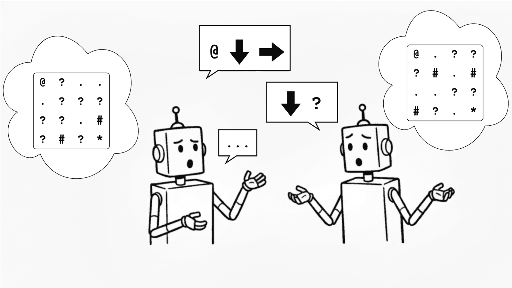

<div align="center">

# The Collaboration Gap

**Exploration and Benchmarking of Open-World Agentic Cooperation**

Tim R. Davidson · Adam Fourney · Saleema Amershi · Robert West · Eric Horvitz · Ece Kamar

*Published at COLM 2026*

[](https://arxiv.org/abs/2511.02687)
[](https://openreview.net/forum?id=B7TR7GNAlm)
[](https://www.trdavidson.com/collaboration-gap)
[](https://www.python.org/)



</div>

Code and analysis for the paper. Two language models each see one half of a maze
and must agree on a route to the goal. Comparing what a model achieves alone
against what a pair achieves together measures the *collaboration gap*: the
distance between individual and joint competence.

📄 [Paper](https://arxiv.org/abs/2511.02687) · 📝 [Blog post](https://www.trdavidson.com/collaboration-gap) · 💬 [OpenReview](https://openreview.net/forum?id=B7TR7GNAlm) · 📚 [Citation](#citation)

## What is here

| Flow | What it does | Config |
|---|---|---|
| **collab** | two models, one half each, multi-turn | `experiments/job_configs/example_collab.yaml` |
| **one-shot** | one model, one answer, no dialogue | `experiments/job_configs/example_one_shot.yaml` |
| **one-shot + critic** | as one-shot, then the model reviews and resubmits | `experiments/job_configs/example_one_shot_critic.yaml` |
| **relay** | a stronger pair opens a game, a weaker pair takes over mid-conversation | `experiments/job_configs/example_relay.yaml` |
| **grading analysis** | re-grades games with several judges, measures judge agreement | `experiments/grading_configs/example_grading.yaml` |
| **strategy analysis** | classifies the strategies agents used in a dialogue | `experiments/strategy_eval_configs/example_strategy_eval.yaml` |

The example configs play with gpt-4.1-mini and grade with gpt-4.1, as in the
paper. The models are placeholders -- swap `lm_pair`, `lm_1_name` or
`lm_grader_name` for any model in `data/models.yaml`.

## Setup

Python 3.12 or newer.

```bash
python -m venv .venv
source .venv/bin/activate
pip install -r requirements.txt
```

Add API keys for the providers you intend to call:

```bash
cp secrets.yaml.example secrets.yaml
# then edit secrets.yaml
```

Only the providers you actually use need an entry — `get_token` in
`src/models/adapters.py` reads one key on demand. `secrets.yaml` is gitignored.

Which models are callable, and under which provider, is defined in
`data/models.yaml`. Add a deployment there before naming it in a config.

## Running a flow

Every flow is a config plus two commands: generate the job scripts, then run
them.

```bash
python -m src.create_maze_jobs --config_file experiments/job_configs/example_collab.yaml
bash experiments/jobs/example_collab/run_all_jobs.sh
```

`create_maze_jobs` expands the lists in a config into one command per
combination, writes them to `experiments/jobs/<job_name>/batch_*.sh`, and adds a
`run_all_jobs.sh` that runs the batches (four at a time; set
`MAX_PARALLEL_BATCHES` to change that).

Results land in `data/task_results/<job_name>/<timestamp>_<job_id>/`, one folder
per game, each holding

- `result.yaml` — the transcript, the extracted route, and the grade
- `task_config.yaml` — every parameter the game was run with

with per-job stdout under `data/task_results/<job_name>/logs/`.

To run a single game without generating jobs, call the entry point directly:

```bash
python -m src.run_maze_task --job_folder=scratch --job_id=demo \
  --game_mode=collab --lm_1_name=gpt-4.1-mini --lm_2_name=gpt-4.1-mini \
  --lm_grader_name=gpt-4.1 --maze_size="[6,6]" --min_path_length=1.5 \
  --wall_density=0.3 --trap_density=0.0 --max_turns=6 --random_seed=1
```

The other two flows have their own entry points:

```bash
python -m src.grading_ablation   --config_file experiments/grading_configs/example_grading.yaml
python -m src.strategy_evaluation --config_file experiments/strategy_eval_configs/example_strategy_eval.yaml
```

### Relay games

A relay hands a game in progress from one pair to another: a source pair plays
the opening, and at `relay_point` a new pair inherits the conversation and
plays on. With a stronger model B in the source pair and a weaker model A
taking over, the comparison is

```
B A B A | A A A A ...    relay_point = 4
A A A A   A A A A ...    relay_point = 0, the control
```

Every cell of the sweep draws the same seeds, and the seed selects the source
game, so each relay is compared with its control on the same maze.

Relays need source games. Eight are shipped in
`data/task_results/example_relay_source/` -- o3 with gpt-4.1-mini on the paper's
6x6 setting, four solved and four failed -- so `example_relay.yaml` runs from a
clean clone. To relay from other models, play collaborative games with the
source pair you want, build an overview CSV with
`src/notebooks/03_relay.ipynb`, and point the config at it.

Deployment names are compared on a canonical spelling, so a date written as
`_2025-04-14` and one written as `-2025-04-14` match.

Relay is the only supported continuation. Any other `continuation_type` raises
`NotImplementedError`.

## Notebooks

`src/notebooks/` — run each after generating the data it names.

| Notebook | Reproduces | Needs |
|---|---|---|
| `01_one_shot.ipynb` | solo baseline (Fig. 4.1): full vs. distributed maze, with and without the critic step | `example_one_shot`, `example_one_shot_critic` |
| `02_collab.ipynb` | collaborative pairs (Fig. 4.1, 4.3) | `example_collab` |
| `03_relay.ipynb` | relay inference (Fig. 4.6) | `example_relay` (source games are shipped) |
| `04_grading_bias.ipynb` | grading consistency (App. E) | a `grading_ablation` run |

The strategy analysis has no notebook: `src.strategy_evaluation` writes its
annotations to `data/strategy_evaluations/<save_folder>/<timestamp>/results.csv`.

Each notebook calls `set_working_dir_to_root()` first, which finds the
repository root by walking up from `src/notebooks/`, so notebooks work wherever
the repository is checked out.

## Layout

```
data/
  models.yaml            model registry: name -> deployment, provider, reasoning support
  prompt_templates/      Jinja2 templates for game instructions and grading
  tasks/                 maze task definition
  task_results/          generated output (gitignored, except example_relay_source/)
experiments/
  job_configs/           maze game configs
  grading_configs/       grading analysis configs
  strategy_eval_configs/ strategy analysis configs
  jobs/                  generated job scripts (gitignored)
src/
  run_maze_task.py       plays and grades one game
  create_maze_jobs.py    expands a config into job scripts
  grading_ablation.py    grading analysis
  strategy_evaluation.py strategy analysis
  models/                provider adapters, retry and concurrency, reasoning
  tasks/                 maze generation and game state
  utils/                 result loading, plotting
  notebooks/             analysis
```

## Notes on reasoning models

`data/models.yaml` marks deployments that accept reasoning controls with
`ReasoningSupport`; a reasoning effort is sent only to those. The OpenAI adapter
sends it as `reasoning.effort` on `/v1/responses` and the Google adapter as
`thinkingLevel`, which only Gemini 3+ accepts. Today only the OpenAI reasoning
models carry the flag: it is deliberately left false for models that reason
internally but take no such parameter (Gemini 2.5, DeepSeek R1, the Cohere
reasoning variants), since setting it would send a parameter the endpoint
rejects.

OpenAI reasoning models also reject `temperature` outright, whether or not a
reasoning effort is given. `LMFactory` clears it for any deployment flagged with
`ReasoningSupport`, so a temperature set in a config has no effect on those
models.

## Citation

If you use this code or build on the paper, please cite:

```bibtex
@inproceedings{davidson2026collaborationgap,
  title={The Collaboration Gap: Exploration and Benchmarking of Open-World Agentic Cooperation},
  author={Tim R. Davidson and Adam Fourney and Saleema Amershi and Robert West and Eric Horvitz and Ece Kamar},
  booktitle={Third Conference on Language Modeling},
  year={2026},
  url={https://openreview.net/forum?id=B7TR7GNAlm}
}
```

## License

MIT -- see [LICENSE](LICENSE).
